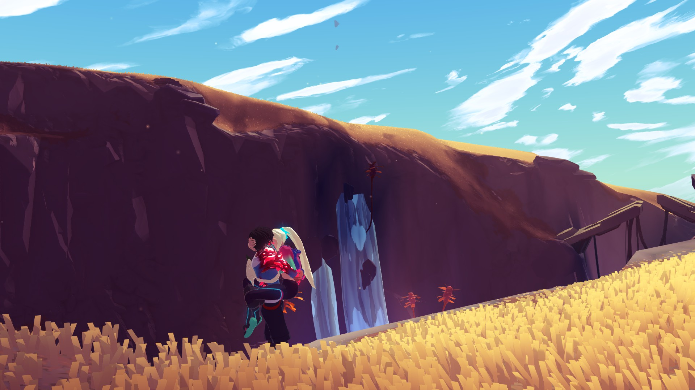

# Haven: Life on Source

**A fan-made mod for [Haven](https://www.thegamebakers.com/haven/) that lets you keep living on Source after the Flow Bridge ending.**

> [!IMPORTANT]
> **Unofficial mod.** Haven: Life on Source is a fan project for *Haven*. It is **not affiliated with, endorsed by, or supported by The Game Bakers**. *Haven* and all related names, characters and content are the property of The Game Bakers. You need your own legitimate copy of the game to use this mod. This repository contains only original mod code: no game files, assets or decompiled source.

> [!WARNING]
> **Spoilers.** This page discusses the end of *Haven*'s story and its epilogue.

<p align="center">
  
  <br>
  <em>Still on Source after the credits, roaming free with the mod installed.</em>
</p>

---

## What it does

In the base game, when you choose to destroy the Flow Bridge, the epilogue plays. Once you sleep in the Nest, the final scene and credits roll and you are sent back to the main menu. The epilogue never saves, so choosing **Epilogue** on the title screen takes you back to when you picked up the Flower Boots, every time.

**Haven: Life on Source** turns the ending into a beginning:

| Feature | Details |
| --- | --- |
| **Stay after the credits** | After the final scene and credits you stay in the Nest instead of going to the main menu, and the game saves. *Epilogue* on the title screen now resumes after the ending. |
| **Saving works again** | The epilogue's save block is lifted once the ending has played. |
| **The Nest is yours again** | Leaving the Nest, cooking, crafting, curing, synthesizing, eating, drinking, the garden and upgrades all work again after the ending. The cockpit's ship launch stays hidden, since the ship has already taken off. Kay and Yu's idle animations in the Nest follow the game's usual context-based rules again (resting when tired, at the bench when an upgrade is ready, the occasional couch moment) instead of staying in the epilogue's fixed pose. |
| **Flow Bridge Stabilizer** | A new upgrade at the **Enhance** bench. It costs **1× Hyperrust** and lets you cross flow bridges safely, with or without the Flower Boots on. It also brings back Birble fast travel from bait stations. If you've already spent all your Hyperrust, you're given 1 for it. |
| **Fitting chatter** | Once the bridge is severed, the roaming chatter about Ozias coming to Source no longer plays. The rest of the chatter, with the original voice acting, still does. |
| **Checkpoint for future content** | An optional hook runs before each bridge crossing after the ending, for future content where Yu hesitates to risk the bridges. For now it does nothing in game. |

Everything can be switched on or off in the config file.

---

## Requirements

- *Haven* for PC (Steam), Windows. Tested on the October 2025 Steam build (Unity 2019.4.28).
- [BepInEx 5](https://github.com/BepInEx/BepInEx/releases) for **Windows x64**. Tested with **5.4.23.2**. BepInEx 6 is not supported.

## Installation

1. **Install BepInEx 5.** Download `BepInEx_win_x64_5.4.23.2.zip` from the [BepInEx releases](https://github.com/BepInEx/BepInEx/releases/tag/v5.4.23.2) and extract it into your Haven folder (the one with `Haven.exe`).
   *Steam: right-click Haven → Manage → Browse local files.*
2. **Run Haven once** and quit. This lets BepInEx create its folders.
3. **Install the mod.** Download the latest `HavenLifeOnSource-x.y.z.zip` from [Releases](../../releases) and extract it into the same Haven folder, so that you end up with:
   ```
   Haven/
   ├─ Haven.exe
   ├─ winhttp.dll                 (BepInEx)
   └─ BepInEx/
      └─ plugins/
         └─ HavenLifeOnSource.dll
   ```
4. Start the game. `BepInEx/LogOutput.log` should contain `Haven: Life on Source 1.4.3 loaded`.

> [!TIP]
> **Back up your saves first.** They're in `%USERPROFILE%\AppData\LocalLow\TheGameBakers\Haven`.

## How to play

1. Finish the story by **destroying the Flow Bridge**.
2. Play the epilogue as normal, then **sleep in the Nest** to trigger the final scene.
3. After the credits you're back in control in the Nest and the game saves. From then on, **Epilogue** on the title screen resumes here.
4. Go to the **Enhance** bench and build the **Flow Bridge Stabilizer** (1× Hyperrust) to cross the flow bridges again. ( This is absolutely up for debate/changes )

Already finished the game without the mod? Load **Epilogue**, get the boots, sleep in the Nest, and watch the credits again. The mod takes over from there.

## Configuration

The config file `BepInEx/config/lifeonsource.haven.cfg` is created the first time you run the game with the mod.

| Section | Setting | Default | Description |
| --- | --- | --- | --- |
| General | `Enabled` | `true` | Master switch. Stay in the world after the epilogue's credits. |
| General | `UnlockNestActivities` | `true` | Lift the epilogue's locks on Nest activities after the ending. |
| General | `RestoreNestIdles` | `true` | Use the game's normal, context-based Nest idle animations after the ending instead of the epilogue's fixed couch/bed poses. |
| General | `DisableShipLaunch` | `true` | Keep the cockpit's ship launch option hidden after the ending, since the ship has already taken off. |
| Bridges | `BridgeAccess` | `RequireStabilizer` | `RequireStabilizer`: build the Flow Bridge Stabilizer to cross. `AlwaysOpen`: bridges open right after the ending. `Vanilla`: bridges stay locked. |
| Bridges | `BirbleTravel` | `true` | Bait stations work again after the ending, so Birble can give you a lift. Follows `BridgeAccess`: with `RequireStabilizer`, build the Flow Bridge Stabilizer first. |
| Bridges | `YuBridgeHesitance` | `false` | Turns on the bridge-crossing checkpoint for future content. Currently it only logs crossings. |
| Dialogue | `DisableOziasArrivalLines` | `true` | Skip the roaming chatter about Ozias coming to Source once the bridge is severed. |

## Uninstalling

Delete `BepInEx/plugins/HavenLifeOnSource.dll`. To remove BepInEx too, also delete the `BepInEx` folder, `winhttp.dll`, `doorstop_config.ini` and `.doorstop_version`.

Saves made with the mod still load without it. You'll simply be back to the vanilla epilogue behaviour.

## Known limitations

- **The new upgrade's name is English only.** In other languages, "Flow Bridge Stabilizer" shows in English.
- **Not every island has been tested.** Exploring other islands after the ending hasn't been checked everywhere yet, and some places may still have epilogue-specific behaviour. Please report anything odd.
- **Steam/PC only.** It doesn't work on console versions.

## Reporting a problem

Open an [issue](../../issues) and include:
- `BepInEx/LogOutput.log`
- `%USERPROFILE%\AppData\LocalLow\TheGameBakers\Haven\Player.log`
- what you were doing when it happened

---

## For developers

### Building

You need the [.NET SDK](https://dotnet.microsoft.com/download) (6 or later) plus your own Haven install with BepInEx 5. The project compiles against the game's and BepInEx's DLLs straight from that install. None of them are included in this repository.

```powershell
# Default path: C:\Program Files (x86)\Steam\steamapps\common\Haven
dotnet build src/HavenLifeOnSource -c Release

# Custom install path
dotnet build src/HavenLifeOnSource -c Release -p:HavenDir="D:\SteamLibrary\steamapps\common\Haven"
# or: $env:HAVEN_DIR = "D:\SteamLibrary\steamapps\common\Haven"
```

To build and zip a release into `dist/`:

```powershell
./tools/package.ps1 -HavenDir "D:\SteamLibrary\steamapps\common\Haven"
```

### How it works

<details>
<summary>Technical overview (spoilers)</summary>

Haven is a Unity (Mono) game. Its story runs on **Ink**, **PlayMaker** FSMs and the game's own "IGS" scripted scenes. The mod uses Harmony patches only: no game files are modified.

| Patch | Purpose |
| --- | --- |
| `LoadMainMenuFsmAction.Execute` | In the epilogue's final scene (`Epilogue_Unique_Sleep_TheEnd`), skip the jump to the main menu. The FSM then moves to its `Trigger` state, where `EndEventHandler` calls `IGSManager.OnFsmEnd` and the scene ends normally. |
| `IGSManager.OnIGSEnd` | After that scene ends, fade the screen back in if needed, mark the ending story event as played, clear the `Epilogue_PreventGameSave` global variable, and request a save. |
| `FunctionCondition.IsValidInternal` | After the ending, the `IsInEpilogue` check reports false, but only to `ActivityParams` (Nest activities), `NestIdleResources` (the Nest idle list, whose `Epilogue-Bed`/`Epilogue-Couch` entries would otherwise always win) and the `ActionParams` named `*BridgeLock*` (the home island's bridge locks) and `Panel_GPE_InteractInternal_Bait` (bait stations used to call Birble). Other epilogue effects stay. |
| `WorkshopManager.Instance` + `WorkshopPartInfo` getters | Add the *Flow Bridge Stabilizer* part to the Enhance workshop and show it only after the ending. Its built state is saved by the game under its part id. |
| `DialogManager.InternalStartStory` | For the zone 6 `ChitChatAfterOzias_*` chatter, preview which variant the Ink cycle is about to play. If it's one about Ozias arriving, count it as played so the next variant plays. Otherwise restore the story state exactly. |
| `BridgeGPE.OnBridgeTrigger` | Optional bridge-crossing checkpoint (`Plugin.BeforePostEndingBridgeCross`). |
| `LocalizationManager.UpdateLocalizationDictionary` | Adds the mod's own text. |

</details>

### Extending: the bridge-crossing checkpoint

With `YuBridgeHesitance = true`, other plugins can hook bridge crossings after the ending:

```csharp
HavenLifeOnSource.Plugin.BeforePostEndingBridgeCross += bridge =>
{
    // return false to make Kay and Yu turn back, like a vanilla bridge lock
    return true;
};
```

---

## Credits

- **Haven** by [The Game Bakers](https://www.thegamebakers.com/). Please support the developers.
- [BepInEx](https://github.com/BepInEx/BepInEx) and [HarmonyX](https://github.com/BepInEx/HarmonyX), which make this mod possible.
- Developed with the help of AI tools (Claude by Anthropic).

## License

The mod's source code is released under the [MIT License](LICENSE). This covers **only** the original code in this repository. It grants no rights to *Haven* or any content owned by The Game Bakers. See [THIRD-PARTY-NOTICES.md](THIRD-PARTY-NOTICES.md).

If you represent The Game Bakers and want something changed or removed, please open an issue or get in touch and it will be dealt with promptly.
