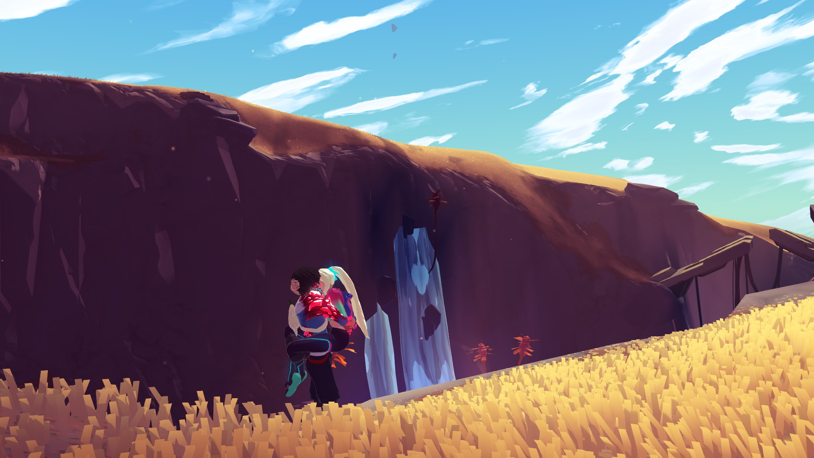

<h1 align="center">Haven: Life on Source</h1>

<p align="center">
  <strong>The credits roll. Kay and Yu stay.</strong><br>
  A fan-made mod for <a href="https://www.thegamebakers.com/haven/"><em>Haven</em></a> that turns the Flow Bridge ending into a beginning.
</p>

<p align="center">
  <a href="../../releases/latest"></a>
  <a href="../../releases"></a>
  
  
  <a href="LICENSE"></a>
</p>

<p align="center">
  <a href="../../releases/latest"><strong>⬇ Download the latest release</strong></a>
  &nbsp;·&nbsp;
  <a href="#quick-start">Quick start</a>
  &nbsp;·&nbsp;
  <a href="#features">Features</a>
  &nbsp;·&nbsp;
  <a href="#configuration">Configuration</a>
  &nbsp;·&nbsp;
  <a href="../../issues">Report a problem</a>
</p>

<p align="center">
  
  <br>
  <em>Still on Source after the credits, roaming free with the mod installed.</em>
</p>

> [!WARNING]
> **Spoilers ahead.** This page talks about the end of *Haven*'s story and its epilogue.

> [!IMPORTANT]
> **Unofficial fan mod.** Not affiliated with, endorsed by, or supported by The Game Bakers. *Haven* and all related names, characters and content belong to The Game Bakers. You need your own copy of the game. This repository holds only original mod code: no game files, assets or decompiled source.

---

## Why this mod?

In the base game, destroying the Flow Bridge sends you into the epilogue. Sleep in the Nest, the final scene and credits roll, and you land back on the main menu. The epilogue never saves, so picking **Epilogue** on the title screen puts you back at the Flower Boots, every time.

**Life on Source lets you stay after the credits.** The game saves, the Nest works again, and with one new upgrade you can cross the bridges and explore Source with Kay and Yu for as long as you like.

## Features

| | Feature | What you get |
| :---: | --- | --- |
| 🌅 | **Stay after the credits** | After the final scene you wake up in the Nest instead of the main menu, and the game saves. *Epilogue* on the title screen now resumes after the ending. |
| 💾 | **Saving works again** | The epilogue's save block is lifted once the ending has played. |
| 🏡 | **The Nest is yours again** | Leaving the Nest, cooking, crafting, curing, synthesizing, eating, drinking, the garden and upgrades all come back. Kay and Yu's idle animations follow the game's usual context-based rules again (resting when tired, at the bench when an upgrade is ready, the occasional couch moment) instead of staying in the epilogue's fixed pose. The cockpit's ship launch stays hidden, since the ship has already taken off. |
| 🌉 | **Flow Bridge Stabilizer** | A new upgrade at the **Enhance** bench for **1× Hyperrust**. Cross flow bridges safely, with or without the Flower Boots, and use Birble fast travel from bait stations again. If you've already spent all your Hyperrust, you're given 1. |
| 💬 | **Chatter that fits** | Once the bridge is severed, the roaming chatter about Ozias coming to Source stops. All other chatter still plays, with the original voice acting. |
| 🧩 | **Room to grow** | An optional hook runs before each bridge crossing after the ending, ready for future content where Yu hesitates to risk the bridges. For now it does nothing in game. |

Every feature can be switched on or off in the [config file](#configuration).

---

## Quick start

**You need:** *Haven* for PC on Steam (Windows). Tested on the October 2025 Steam build (Unity 2019.4.28). The recommended download already includes the [BepInEx](https://github.com/BepInEx/BepInEx) mod loader, so there's nothing else to install.

1. **Download** `HavenLifeOnSource-x.y.z-with-BepInEx.zip` from the [latest release](../../releases/latest).
2. **Open your Haven folder.** In Steam, right-click **Haven → Manage → Browse local files**. It's the folder with `Haven.exe` in it.
3. **Extract the zip into that folder.** Right-click the zip → **Extract All…**, choose the Haven folder, and allow it to replace files if asked.
4. **Play.** Start Haven from Steam as usual.

> [!TIP]
> **Back up your saves first.** They're in `%USERPROFILE%\AppData\LocalLow\TheGameBakers\Haven`.

<details>
<summary><strong>What the Haven folder looks like afterwards</strong></summary>

```
Haven/
├─ Haven.exe
├─ winhttp.dll                 ← mod loader (BepInEx)
├─ doorstop_config.ini         ← mod loader (BepInEx)
├─ HavenLifeOnSource/          ← this mod's readme and licenses
└─ BepInEx/
   ├─ core/                    ← mod loader (BepInEx)
   └─ plugins/
      └─ HavenLifeOnSource.dll ← the mod
```

</details>

<details>
<summary><strong>Already have BepInEx 5 installed?</strong></summary>

Download `HavenLifeOnSource-x.y.z.zip` (plugin only) instead and extract it into your Haven folder. Use BepInEx 5 for Windows x64; BepInEx 6 isn't supported.

</details>

<details>
<summary><strong>Is it working?</strong></summary>

After starting the game once, open `BepInEx/LogOutput.log` in the Haven folder. It should contain `Haven: Life on Source 1.4.4 loaded`. If the `BepInEx` folder has no `LogOutput.log`, the loader didn't start: make sure `winhttp.dll` sits right next to `Haven.exe`.

</details>

## How to play

1. Finish the story by **destroying the Flow Bridge**.
2. Play the epilogue as normal, then **sleep in the Nest** to trigger the final scene.
3. After the credits you're back in control in the Nest and the game saves. From then on, **Epilogue** on the title screen resumes here.
4. Build the **Flow Bridge Stabilizer** (1× Hyperrust) at the **Enhance** bench to cross the flow bridges again.

**Already finished the game without the mod?** Load **Epilogue**, get the boots, sleep in the Nest and watch the credits again. The mod takes over from there.

> [!NOTE]
> The Stabilizer's cost and how bridge access works are still open for discussion. Ideas are welcome in the [issues](../../issues).

## Configuration

`BepInEx/config/lifeonsource.haven.cfg` is created the first time you run the game with the mod.

| Section | Setting | Default | Description |
| --- | --- | --- | --- |
| General | `Enabled` | `true` | Master switch. Stay in the world after the epilogue's credits. |
| General | `UnlockNestActivities` | `true` | Lift the epilogue's locks on Nest activities after the ending. |
| General | `RestoreNestIdles` | `true` | Use the game's normal, context-based Nest idle animations after the ending instead of the epilogue's fixed couch/bed poses. |
| General | `DisableShipLaunch` | `true` | Keep the cockpit's ship launch option hidden after the ending, since the ship has already taken off. |
| Bridges | `BridgeAccess` | `RequireStabilizer` | `RequireStabilizer`: build the Flow Bridge Stabilizer to cross. `AlwaysOpen`: bridges open right after the ending. `Vanilla`: bridges stay locked. |
| Bridges | `BirbleTravel` | `true` | Bait stations work again after the ending, so Birble can give you a lift. Follows `BridgeAccess`: with `RequireStabilizer`, build the Flow Bridge Stabilizer first. |
| Bridges | `YuBridgeHesitance` | `false` | Turns on the bridge-crossing checkpoint for future content. Currently it only logs crossings. |
| Dialogue | `DisableOziasArrivalLines` | `true` | Skip the roaming chatter about Ozias coming to Source once the bridge is severed. |

## Known limitations

- **The new upgrade's name is English only.** In other languages, "Flow Bridge Stabilizer" shows in English.
- **Not every island has been tested.** Exploring other islands after the ending hasn't been checked everywhere yet, and some places may still have epilogue-specific behaviour. Please report anything odd.
- **Steam/PC only.** It doesn't work on console versions.

## Uninstalling

Delete `BepInEx/plugins/HavenLifeOnSource.dll` and the `HavenLifeOnSource` folder. To remove the BepInEx mod loader too, also delete the `BepInEx` folder, `winhttp.dll`, `doorstop_config.ini`, `.doorstop_version` and `changelog.txt`.

Saves made with the mod still load without it. You'll simply be back to the vanilla epilogue behaviour.

## Reporting a problem

Found a bug or something that feels off? [Open an issue](../../issues) and include:

- `BepInEx/LogOutput.log`
- `%USERPROFILE%\AppData\LocalLow\TheGameBakers\Haven\Player.log`
- what you were doing when it happened

See the [changelog](CHANGELOG.md) for what changed in each release.

---

## For developers

### Building

You need the [.NET SDK](https://dotnet.microsoft.com/download) (6 or later) plus your own Haven install with BepInEx 5. The project compiles against the game's and BepInEx's DLLs straight from that install. None of them are included in this repository.

```powershell
# Default path: C:\Program Files (x86)\Steam\steamapps\common\Haven
dotnet build src/HavenLifeOnSource -c Release

# Custom install path
dotnet build src/HavenLifeOnSource -c Release -p:HavenDir="D:\SteamLibrary\steamapps\common\Haven"
# or: $env:HAVEN_DIR = "D:\SteamLibrary\steamapps\common\Haven"
```

To build and zip a release into `dist/`:

```powershell
./tools/package.ps1 -HavenDir "D:\SteamLibrary\steamapps\common\Haven"
```

### How it works

<details>
<summary>Technical overview (spoilers)</summary>

Haven is a Unity (Mono) game. Its story runs on **Ink**, **PlayMaker** FSMs and the game's own "IGS" scripted scenes. The mod uses Harmony patches only: no game files are modified.

| Patch | Purpose |
| --- | --- |
| `LoadMainMenuFsmAction.Execute` | In the epilogue's final scene (`Epilogue_Unique_Sleep_TheEnd`), skip the jump to the main menu. The FSM then moves to its `Trigger` state, where `EndEventHandler` calls `IGSManager.OnFsmEnd` and the scene ends normally. |
| `IGSManager.OnIGSEnd` | After that scene ends, fade the screen back in if needed, mark the ending story event as played, clear the `Epilogue_PreventGameSave` global variable, and request a save. |
| `FunctionCondition.IsValidInternal` | After the ending, the `IsInEpilogue` check reports false, but only to `ActivityParams` (Nest activities), `NestIdleResources` (the Nest idle list, whose `Epilogue-Bed`/`Epilogue-Couch` entries would otherwise always win) and the `ActionParams` named `*BridgeLock*` (the home island's bridge locks) and `Panel_GPE_InteractInternal_Bait` (bait stations used to call Birble). Other epilogue effects stay. |
| `WorkshopManager.Instance` + `WorkshopPartInfo` getters | Add the *Flow Bridge Stabilizer* part to the Enhance workshop and show it only after the ending. Its built state is saved by the game under its part id. |
| `DialogManager.InternalStartStory` | For the zone 6 `ChitChatAfterOzias_*` chatter, preview which variant the Ink cycle is about to play. If it's one about Ozias arriving, count it as played so the next variant plays. Otherwise restore the story state exactly. |
| `BridgeGPE.OnBridgeTrigger` | Optional bridge-crossing checkpoint (`Plugin.BeforePostEndingBridgeCross`). |
| `LocalizationManager.UpdateLocalizationDictionary` | Adds the mod's own text. |

</details>

### Extending: the bridge-crossing checkpoint

With `YuBridgeHesitance = true`, other plugins can hook bridge crossings after the ending:

```csharp
HavenLifeOnSource.Plugin.BeforePostEndingBridgeCross += bridge =>
{
    // return false to make Kay and Yu turn back, like a vanilla bridge lock
    return true;
};
```

---

## Credits

- **Haven** by [The Game Bakers](https://www.thegamebakers.com/). If you enjoyed Kay and Yu's story, please support the developers.
- [BepInEx](https://github.com/BepInEx/BepInEx) and [HarmonyX](https://github.com/BepInEx/HarmonyX), which make this mod possible.
- Developed with the help of AI tools (Claude by Anthropic).

## License

The mod's source code is released under the [MIT License](LICENSE). This covers **only** the original code in this repository. It grants no rights to *Haven* or any content owned by The Game Bakers. See [THIRD-PARTY-NOTICES.md](THIRD-PARTY-NOTICES.md).

If you represent The Game Bakers and want something changed or removed, please open an issue or get in touch and it will be dealt with promptly.

<p align="center"><em>Made with love for Kay, Yu and Source.</em></p>
